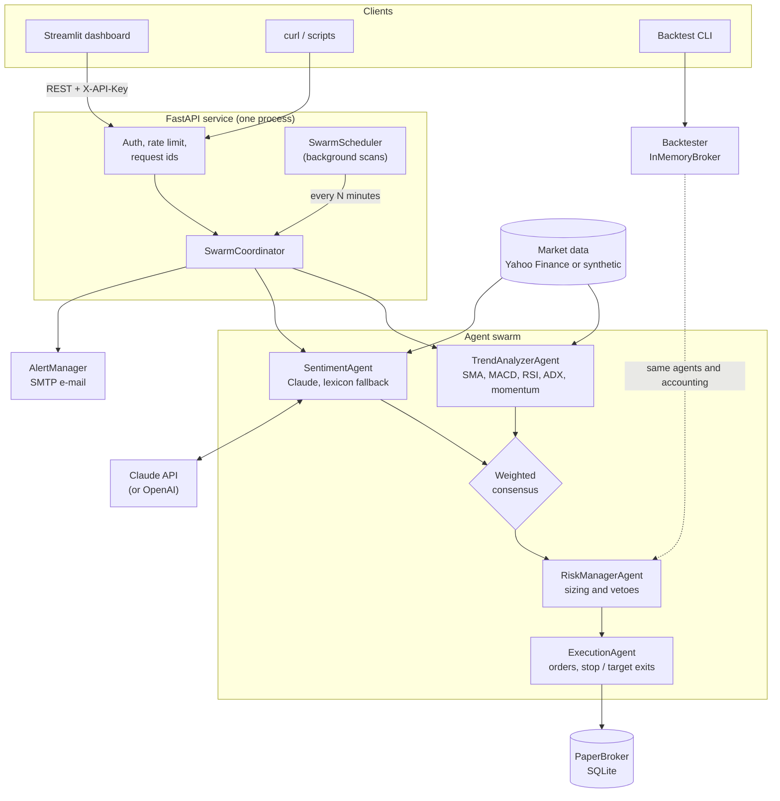
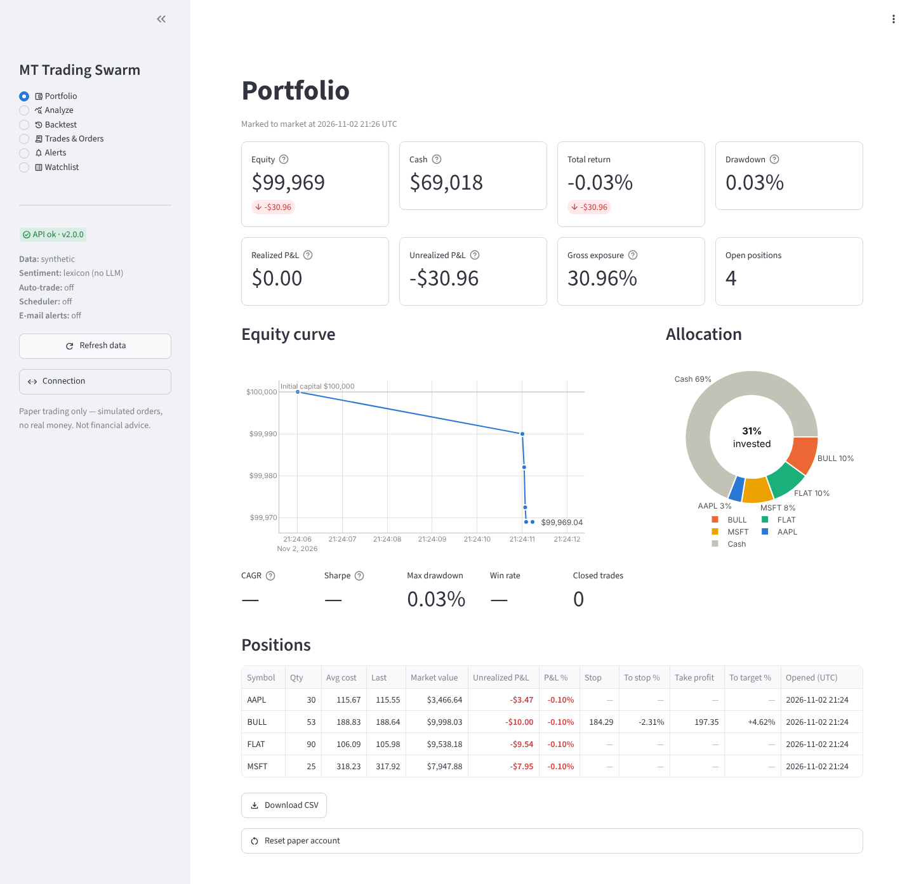
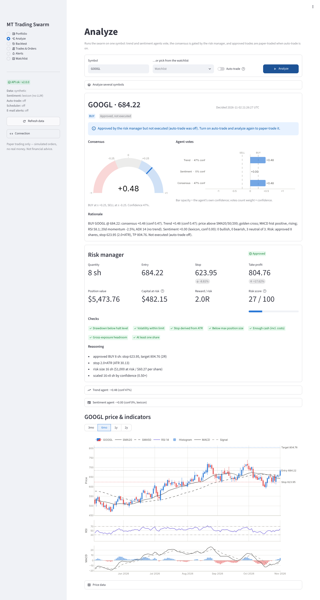
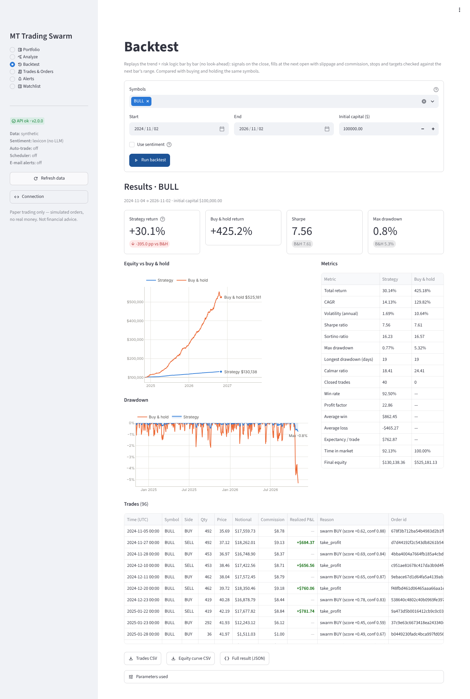

# MT Trading Swarm

[](https://github.com/Mayank-thakur21/-mt-trading-swarm/actions/workflows/ci.yml?query=branch%3Amain)


[](https://github.com/astral-sh/ruff)

A multi-agent **paper-trading** system. A technical **trend** agent and a **news-sentiment**
agent (Claude by default) vote on each stock. A weighted consensus turns the votes into
BUY / SELL / HOLD. A **risk manager** sizes the trade or vetoes it, and an **execution**
agent books it in a SQLite paper portfolio, where stop-losses and take-profits are actually
enforced (on every analysis and every watchlist scan). Around that core you get an event-driven **backtester** with no look-ahead,
**e-mail alerts**, a background **scheduler**, a FastAPI **REST API** and a **Streamlit
dashboard**.

> [!WARNING]
> **Paper trading only. Not financial advice.** MT Trading Swarm trades a simulated
> account. It never connects to a broker and never moves real money. Its signals come from
> heuristics and a language model, and they can be wrong. Backtested results do not predict
> future returns. Use it for research and learning.

## Contents

- [Features](#features)
- [Architecture](#architecture)
- [How a decision is made](#how-a-decision-is-made)
- [Quick start](#quick-start)
- [Configuration](#configuration)
- [LLM setup: Claude and OpenAI](#llm-setup-claude-and-openai)
- [E-mail alerts](#e-mail-alerts)
- [Scheduler](#scheduler)
- [Backtesting](#backtesting)
- [REST API reference](#rest-api-reference)
- [Dashboard tour](#dashboard-tour)
- [Testing and quality gates](#testing-and-quality-gates)
- [Project structure](#project-structure)
- [What changed in 2.0](#what-changed-in-20)
- [Roadmap](#roadmap)

## Features

- **Explainable agents.** Every vote carries its indicator values, component scores and a
  plain-English rationale. Every decision gets a deterministic summary of the vote, for
  example *"Trend +0.74 (conf 0.82): price above SMA20/50/200; golden cross …"*.
- **Claude news sentiment** through the official `anthropic` SDK with structured JSON
  output. Headlines are treated as untrusted data. If the LLM is off or fails, a finance
  lexicon that handles negation takes over. OpenAI is an optional alternative.
- **Real risk management.** Fixed-fractional sizing with an ATR stop. Caps for position
  size, cash and gross exposure. A drawdown circuit breaker, a volatility veto and a
  0-100 risk score.
- **Persistent, thread-safe paper broker** on SQLite. Slippage and commission are
  modelled, P&L is realized and unrealized, positions keep their stops and targets, and
  the equity history, decisions, alert log and watchlist all survive a restart.
- **Honest backtests.** Daily bars, decisions at the close, fills at the next open, stops
  and targets checked against each bar's range (gaps fill at the open), an equal-weight
  buy-and-hold benchmark, and the same agents and accounting code as live trading.
- **E-mail alerts** for strong signals, fills, stop-loss and take-profit exits, drawdown
  breaches and large daily moves. Repeats are held back by a cooldown and every outcome
  is logged.
- **Market-hours scheduler** with the NYSE holiday calendar and 13:00 early closes.
- **Production API.** API-key auth with constant-time comparison, a per-client rate limit,
  one error format for every failure, request ids in headers and logs, and OpenAPI docs.
- **Dashboard** with a portfolio view, an analysis page (gauge, agent votes, risk panel,
  candlesticks with SMA, RSI and MACD), backtests, trades and orders, alerts and the
  watchlist.
- **Works offline.** A deterministic synthetic data provider (`BULL`, `BEAR` and `FLAT`
  scenarios plus canned news) drives the demo and the whole test suite, so nothing needs
  network access.

## Architecture



| Agent | Module | Input | Output |
|---|---|---|---|
| **Trend analyzer** | `trading_swarm/agents/trend.py` | 1 year of daily OHLCV | signal in [-1, 1] from 7 technical components; confidence from component agreement and ADX |
| **Sentiment** | `trading_swarm/agents/sentiment.py` | up to 10 recent headlines | Claude's relevance-weighted score (or the lexicon fallback, confidence at most 0.4) |
| **Risk manager** | `trading_swarm/agents/risk.py` | proposed action, consensus, ATR, volatility, portfolio | approved or vetoed, quantity, stop, take-profit, risk score, every check |
| **Execution** | `trading_swarm/agents/execution.py` | approved decision, latest quote | paper market order with stop and target; enforces exits |
| **Coordinator** | `trading_swarm/swarm.py` | ticker | runs the pipeline and returns a `Decision`, which is persisted and alerted |

Market data comes from `YahooFinanceProvider` (yfinance with a TTL cache and retries) or
`SyntheticProvider` (seeded price regimes with canned news). Both implement the same
`MarketDataProvider` protocol.

## How a decision is made

`POST /analyze` (or a scheduled scan) runs this pipeline for each symbol:

1. Validate the ticker and fetch one year of daily bars. An unknown ticker returns `404`
   and a provider outage returns `502`.
2. Run the **trend** and **sentiment** agents in parallel. An agent that crashes abstains
   (signal 0, confidence 0), so the decision still completes.
3. Combine the votes into a **consensus** and choose BUY, SELL or HOLD by thresholds.
4. Run the **risk gate** against the portfolio, marked with fresh quotes. It sizes the
   trade or vetoes it.
5. If auto-trading is on and the trade is approved, **execute** a paper market order.
6. Send **alerts**, then persist the decision.

Steps 4 and 5 run under one lock, so concurrent analyses (batch requests, the scheduler)
cannot together break the cash or exposure limits.

### 1. Trend vote

Each component is a smooth score in [-1, 1] (positive = bullish). Price distances are
measured in multiples of ATR and momentum as a volatility-adjusted z-score, so the same
thresholds work for a $20 stock and a $2,000 one.

| Component | Weight | Score |
|---|---|---|
| Price vs SMA20 | 0.10 | `tanh((close − SMA20) / (2·ATR))` |
| Price vs SMA50 | 0.15 | `tanh((close − SMA50) / (3·ATR))` |
| Price vs SMA200 | 0.15 | `tanh((close − SMA200) / (5·ATR))` (needs 200 bars) |
| Golden / death cross | 0.15 | `tanh((SMA50 / SMA200 − 1) / 5%)` |
| MACD histogram | 0.20 | `0.6·tanh(hist / (0.2·ATR)) + 0.4·tanh(Δhist / (0.05·ATR))`: sign *and* slope |
| RSI regime | 0.10 | oversold (< 30) → +0.3 to +1; overbought (> 70) → −0.3 to −1; otherwise mild trend-following `0.3·(RSI − 50) / 20` |
| 20-day momentum | 0.15 | `tanh(z / 2)` with `z = R₂₀ / (σ_annual·√(20/252))` |

- `signal = Σ wᵢ·cᵢ / Σ wᵢ`, with the weights renormalised over the components that are
  available.
- `confidence = agreement × (0.5 + 0.5·strength) × history_factor`, where:
  - `agreement = |Σ wᵢ·cᵢ| / Σ wᵢ·|cᵢ|`;
  - `strength = clip((ADX − 15) / 25, 0, 1)`;
  - `history_factor` is 0.85 when there are fewer than 200 bars.
- Below 60 bars the agent returns a neutral "insufficient data" vote.

The indicators are pure pandas functions in `trading_swarm/indicators.py`. RSI and ATR
use Wilder smoothing, the MACD signal line is EMA(MACD, 9), and every indicator is
unit-tested to never look ahead.

### 2. Sentiment vote

- **With an LLM**, Claude scores each headline with a sentiment, a score in [-1, 1] and a
  relevance in [0, 1], and returns its own confidence. The schema is enforced by
  structured output.
  - `signal = Σ scoreᵢ·relevanceᵢ / Σ relevanceᵢ`, falling back to the model's
    `overall_score` when no item has any relevance.
  - `confidence` is the model's confidence.
  - Items that point at a headline that does not exist, or repeat one, are dropped.
- **Without an LLM**, or if the call fails, the lexicon scorer takes over:
  - it matches whole words with light lemmatisation ("beats" matches "beat");
  - it weights terms and phrases, with up to two filler words allowed inside a phrase
    ("raises *full-year* guidance");
  - negation ("not", "no", "never", "n't" …) flips the next terms but stops at
    punctuation and at "but";
  - "miss" and "fail" are bearish and also negate the term that follows them.
  - Its confidence is `0.4 × coverage × agreement`, so it is never above 0.4.
- **No headlines** means the agent abstains: signal 0 and confidence 0.

### 3. Consensus

The vote weights are `vᵢ = wᵢ · cᵢ` (agent weight × agent confidence):

```text
score      = Σ vᵢ·sᵢ / Σ vᵢ                 (0 when Σ vᵢ = 0)
mean_conf  = Σ vᵢ·cᵢ / Σ vᵢ                 (confidence-weighted mean)
agreement  = |Σ vᵢ·sᵢ| / Σ vᵢ·|sᵢ|          (1 = all agents point the same way)
confidence = mean_conf × (0.5 + 0.5·agreement)

action = BUY  if score ≥ BUY_THRESHOLD  (0.25)
         SELL if score ≤ SELL_THRESHOLD (−0.25)
         HOLD otherwise
```

An abstaining agent (`cᵢ = 0`) neither moves the score nor dilutes the confidence.
Agents that contradict each other lower the confidence by up to half.

### 4. Risk gate

**BUY sizing** (fixed-fractional, with a volatility-based stop):

1. `stop = price − ATR(14) × ATR_STOP_MULTIPLE`. If ATR is unavailable the stop is 5 %
   below the price, and it is never closer than 0.5 % of the price.
2. `qty = floor(equity × RISK_PER_TRADE / (price − stop))`. If the stop is hit, the
   account loses `RISK_PER_TRADE` of its equity.
3. Cap the quantity by the position limit `(MAX_POSITION_PCT × equity − current holding) /
   price`, by the cash available after slippage and commission, and by the
   gross-exposure headroom `(MAX_GROSS_EXPOSURE × equity − positions value) / price`.
4. Scale by conviction: `qty = floor(qty × clip(confidence, 0.5, 1))`. For a symbol you
   already hold, the scale applies to the whole position, not to the add-on (see below).
5. `take_profit = price + TAKE_PROFIT_R × (price − stop)`, which is 2R by default.

**Vetoes.** Each of these makes the trade a HOLD with `approved = false`, and every reason
is listed:

- the drawdown from peak is at least `MAX_DRAWDOWN_HALT` (the circuit breaker);
- 20-day realised volatility (annualised) is above `MAX_VOLATILITY`;
- the position limit is already reached;
- the gross-exposure limit is reached;
- there is not enough cash;
- the final size is below one share;
- a protective exit closed the same symbol earlier in the same analysis, batch or scan
  (`reentry_ok`), see [Execution and protective exits](#5-execution-and-protective-exits);
- for an add-on: the price is already at or through the position's stop or target, the
  shares already held use the whole risk budget, the position is already at its
  confidence-scaled target, or the top-up is smaller than 10 % of the shares held
  (`min_add_on_ok`: one- and two-share orders would mostly pay the minimum commission).

**Adding to an open position.** A position has one stop for all of its shares, and an
add-on never loosens it. The broker keeps the higher of the current stop and the new one.
`RISK_PER_TRADE` is therefore the budget of the whole position, measured from the current
price:

1. `stop = max(existing stop, price − ATR × ATR_STOP_MULTIPLE)`.
2. `open_risk = held_qty × (price − stop)`.
3. `room = floor((equity × RISK_PER_TRADE − open_risk) / (price − stop))`, then the caps
   above.
4. Conviction scales the whole position: `target = floor((held_qty + room) ×
   clip(confidence, 0.5, 1))` and the add-on is `target − held_qty`. With `held_qty = 0`
   this is the fresh-entry rule.

Scaling only the add-on would free the held-back part again at every analysis. An
unchanged 0.5-confidence signal re-analysed every hour, or every backtest bar, would then
grow the position to its full unscaled size in a string of ever smaller orders. With the
target rule, re-assessing a signal on the position it produced proposes nothing.

**SELL** closes the whole position. Exits are never blocked by the drawdown or volatility
rules. With no position the SELL becomes a HOLD ("no position to sell"), because the
system is long-only.

**Risk score** (0-100, higher means riskier):
`100 × (0.35·vol/MAX_VOLATILITY + 0.25·exposure/MAX_GROSS_EXPOSURE + 0.25·drawdown/MAX_DRAWDOWN_HALT + 0.15·position/(MAX_POSITION_PCT·equity))`.
Each term is capped at 1.

### 5. Execution and protective exits

- Orders are market orders at the data provider's **latest price**. A client can never
  supply the price.
- The broker fills at `price × (1 ± SLIPPAGE_BPS/10⁴)`, always against you, and charges
  `max(MIN_COMMISSION, notional × COMMISSION_RATE)`.
- The average price includes commission, so realized plus unrealized P&L equals the total
  return.
- If the quote has moved past a protective level since the decision, the stop and the
  target are re-anchored at the same distances from the new price.
- **Adding to a position.** A BUY in a symbol you already hold never lowers the position's
  stop; it keeps the higher of the two. The new take-profit replaces the old one. A BUY
  while the position's stop or target is already breached is rejected, because that
  position is due to be closed.
- **Exits.** Positions whose last price is at or through the stop
  (`reason = "stop_loss"`) or the target (`reason = "take_profit"`) are closed in two
  places. One is every analysis (`POST /analyze`, batch, scheduler), before the risk gate
  runs, for every holding the analysis can quote. The other is every watchlist scan. This
  does not depend on `AUTO_TRADE`: **an analysis with `auto_trade: false` can still sell
  holdings, including other symbols.** Every decision lists those orders in `exits`, and
  its summary describes them. A breached stop is never overwritten by a new entry
  signal.
- **No same-run re-entry.** A symbol closed by its stop or target is not bought back in
  the same analysis, batch or scan. The BUY is vetoed with `reentry_ok = false`. Buying
  back at the price the stop just sold at would pay slippage and commission twice. The
  backtester applies the same rule: it cancels a pending BUY whose position the open
  gapped out of. The next analysis can enter again. A SELL signal on such a symbol reads
  "SELL already done by the stop-loss" rather than "vetoed".
- Every fill (entry, exit or manual order) adds a point to the equity curve, so
  `GET /equity` reflects trading even with the scheduler off. With `SCHEDULER_ENABLED=false`
  and no analyses or scans, nothing checks the stops: run `POST /scan` (or enable the
  scheduler) to keep them enforced.

### Worked example (synthetic `BULL`, $100,000 account)

| Step | Numbers |
|---|---|
| Trend | +0.743, confidence 0.819 (price above all SMAs, golden cross, ADX 63; RSI 85 overbought pulls it down) |
| Sentiment (lexicon) | +0.946, confidence 0.40 (4 of 4 headlines bullish) |
| Vote weights | trend 0.65 × 0.819 = 0.532, sentiment 0.35 × 0.40 = 0.140 |
| Consensus | score (0.532·0.743 + 0.140·0.946) / 0.672 = **+0.785** → BUY; confidence 0.731 |
| Stop | 182.08 − 2 × ATR 1.863 = **178.35** (risk $3.73 per share) |
| Size | $1,000 risk / $3.73 = 268 sh → position cap 20 % → 109 sh → × 0.73 confidence → **79 sh** |
| Target | 182.08 + 2 × 3.73 = **189.54** (2R) |
| Fill | 182.08 × 1.0005 = 182.17, commission $7.20 |

The decision summary reads: *"BUY BULL @ 182.08: consensus +0.79 (conf 0.73). Trend +0.74
(conf 0.82): … Risk: approved 79 shares, stop 178.35 (2.0×ATR), TP 189.54. Executed: BUY
79 @ 182.17."*

## Quick start

### Docker (recommended)

You need Docker with Compose v2.24 or newer.

```bash
git clone https://github.com/Mayank-thakur21/-mt-trading-swarm.git mt-trading-swarm
cd mt-trading-swarm
cp .env.example .env          # optional: add ANTHROPIC_API_KEY, SMTP settings, ...
docker compose up --build     # or: make docker-up
```

- API and interactive docs: <http://localhost:8000/docs>
- Dashboard: <http://localhost:8501>

The paper portfolio lives in the `swarm-data` volume, so it survives `docker compose down`
(`docker compose down -v` deletes it). Both containers run as an unprivileged user and
report health with HEALTHCHECKs. The dashboard waits until the API is healthy.

> [!IMPORTANT]
> Ports are published on `127.0.0.1` only. Before you set `API_BIND=0.0.0.0` (or
> `DASHBOARD_BIND`) to reach the services from other machines, set `API_KEYS` and give the
> dashboard one of the keys as `API_KEY`. Without `API_KEYS` the API accepts any request.

Run a backtest inside the API image:

```bash
docker compose run --rm api python -m scripts.run_backtest --provider synthetic --symbol BULL
```

### Local (Python 3.12 or 3.13)

```bash
python3.13 -m venv .venv && source .venv/bin/activate
make dev                      # runtime + dev dependencies, editable install
make env                      # cp .env.example .env (never overwrites)
make api                      # http://127.0.0.1:8000/docs (auto-reload)
make dashboard                # second terminal: http://localhost:8501
```

Without `make`:

```bash
pip install -r requirements-dev.txt
uvicorn trading_swarm.api.main:app --reload
streamlit run dashboard/app.py
```

### Offline demo, no API keys needed

Set `DATA_PROVIDER=synthetic` (and leave `ANTHROPIC_API_KEY` empty) in `.env`, start the
API, then try the built-in scenarios:

```bash
curl -s -X POST localhost:8000/analyze -H 'Content-Type: application/json' \
     -d '{"symbol": "BULL", "auto_trade": true}' | jq '.action, .summary'
curl -s localhost:8000/portfolio | jq '{equity, cash, positions: [.positions[].symbol]}'
```

`BULL` trends up with bullish news, `BEAR` trends down with bearish news, and `FLAT` is
range-bound with neutral news. Every other ticker gets its own seeded random walk.

## Configuration

All settings come from environment variables or a `.env` file in the working directory.
Real environment variables win over `.env`. Values are validated at start-up: for
example, a `SELL_THRESHOLD` that is not below `BUY_THRESHOLD` stops the app with a clear
error. [`.env.example`](.env.example) lists every variable with its default.

> [!NOTE]
> **Units.** The risk limits are **fractions** (`RISK_PER_TRADE=0.01` means 1 %).
> `SLIPPAGE_BPS` is in basis points. `ALERT_PRICE_MOVE_PCT` is a **percentage** (`5.0`
> means 5 %). In API responses, fields ending in `_pct` are percentages too.

**Application**

| Variable | Default | Description |
|---|---|---|
| `APP_ENV` | `development` | Environment name. With `production`, running without `API_KEYS` is logged as an error rather than a warning. |
| `LOG_LEVEL` | `INFO` | `CRITICAL`, `ERROR`, `WARNING`, `INFO` or `DEBUG`. |
| `LOG_JSON` | `false` | One JSON object per log line (for log shippers) instead of text. |

**Market data**

| Variable | Default | Description |
|---|---|---|
| `DATA_PROVIDER` | `yahoo` | `yahoo` (live yfinance data) or `synthetic` (deterministic, offline). |
| `SYNTHETIC_SEED` | `42` | Seed of the synthetic provider. |
| `CACHE_TTL_SECONDS` | `300` | How long downloaded bars and news are reused. Quotes are cached for at most 60 s. |

**LLM sentiment**

| Variable | Default | Description |
|---|---|---|
| `LLM_PROVIDER` | `anthropic` | `anthropic`, `openai` or `none`. A provider without credentials falls back to `none` (lexicon) with a warning. |
| `ANTHROPIC_API_KEY` | *(empty)* | Claude API key. |
| `ANTHROPIC_USE_SDK_DEFAULT_AUTH` | `false` | With an empty key, let the `anthropic` SDK find credentials itself. |
| `ANTHROPIC_MODEL` | `claude-opus-5-5` | Claude model id. |
| `ANTHROPIC_EFFORT` | `low` | `low`, `medium`, `high`, `xhigh` or `max`: how much the model thinks. |
| `OPENAI_API_KEY` | *(empty)* | OpenAI API key (when `LLM_PROVIDER=openai`). |
| `OPENAI_MODEL` | `gpt-5-mini` | OpenAI model id. |
| `LLM_TIMEOUT_SECONDS` | `30` | Per-request timeout. |
| `LLM_MAX_RETRIES` | `2` | SDK retries on 429, 5xx and connection errors. |

**Storage**

| Variable | Default | Description |
|---|---|---|
| `DATABASE_URL` | `sqlite:///./data/trading_swarm.db` | SQLite file for the portfolio, orders, trades, equity snapshots, decisions, alert log and watchlist. The directory is created on demand. Docker Compose sets `sqlite:////app/data/trading_swarm.db` on the volume. |

**Account and costs**

| Variable | Default | Description |
|---|---|---|
| `INITIAL_CAPITAL` | `100000.0` | Starting cash, also the default for resets and backtests. |
| `COMMISSION_RATE` | `0.0005` | Commission as a fraction of notional (5 bps). |
| `MIN_COMMISSION` | `1.0` | Minimum commission per fill. |
| `SLIPPAGE_BPS` | `5.0` | Adverse slippage in basis points, on both buys and sells. |

**Risk** (fractions)

| Variable | Default | Description |
|---|---|---|
| `RISK_PER_TRADE` | `0.01` | Share of equity lost if a new position's stop is hit. |
| `MAX_POSITION_PCT` | `0.20` | Largest single position as a share of equity. |
| `MAX_GROSS_EXPOSURE` | `0.95` | Largest total position value as a share of equity. |
| `ATR_STOP_MULTIPLE` | `2.0` | Stop distance in ATR(14) multiples. |
| `TAKE_PROFIT_R` | `2.0` | Take-profit at R × the stop distance. |
| `MAX_DRAWDOWN_HALT` | `0.20` | Circuit breaker: no new BUYs once equity is this far below its peak. |
| `MAX_VOLATILITY` | `1.20` | Veto BUYs above this annualised 20-day realised volatility. |
| `RISK_FREE_RATE` | `0.0` | Annual risk-free rate for Sharpe and Sortino. |

**Consensus and trading**

| Variable | Default | Description |
|---|---|---|
| `BUY_THRESHOLD` | `0.25` | Consensus score at or above which the swarm proposes BUY. |
| `SELL_THRESHOLD` | `-0.25` | Consensus score at or below which the swarm proposes SELL. Must be below `BUY_THRESHOLD`. |
| `WEIGHT_TREND` | `0.65` | Trend agent weight (0 disables the agent). |
| `WEIGHT_SENTIMENT` | `0.35` | Sentiment agent weight (0 disables it, so no LLM calls). |
| `AUTO_TRADE` | `false` | Execute approved decisions automatically. The request's `auto_trade` field overrides this. |
| `WATCHLIST` | `AAPL,MSFT,GOOGL,AMZN,NVDA` | Default watchlist. `PUT /watchlist` saves an override in the database. |

**Scheduler**

| Variable | Default | Description |
|---|---|---|
| `SCHEDULER_ENABLED` | `false` | Scan the watchlist in the background, once at start-up and then on a fixed interval. |
| `SCAN_INTERVAL_MINUTES` | `60` | Minutes between scan starts. |
| `MARKET_HOURS_ONLY` | `false` | Scan only during NYSE regular hours. |

**API**

| Variable | Default | Description |
|---|---|---|
| `API_KEYS` | *(empty)* | Comma-separated keys accepted in `X-API-Key`. Empty disables auth, with a warning. |
| `RATE_LIMIT_PER_MINUTE` | `60` | Requests per rolling minute per API key, or per IP without a valid key. |
| `CORS_ORIGINS` | *(empty)* | Comma-separated browser origins allowed to call the API (`*` = any). Empty means none, which is all the server-side dashboard needs. State-changing requests from other browser origins get `403 forbidden_origin`. |
| `DASHBOARD_URL` | `http://localhost:8501` | Base URL for links in alert e-mails. |

**E-mail alerts**

| Variable | Default | Description |
|---|---|---|
| `SMTP_HOST` | *(empty)* | SMTP server. Alerts are on when this, `ALERT_EMAIL_FROM` and `ALERT_EMAIL_TO` are all set. |
| `SMTP_PORT` | `587` | SMTP port. |
| `SMTP_USERNAME` / `SMTP_PASSWORD` | *(empty)* | Login, used when a username is set. The password is never logged. |
| `SMTP_USE_TLS` | `true` | STARTTLS on a plain connection (port 587). |
| `SMTP_USE_SSL` | `false` | Implicit TLS (port 465). If both are true, SSL wins. |
| `ALERT_EMAIL_FROM` | *(empty)* | Sender address. |
| `ALERT_EMAIL_TO` | *(empty)* | Comma-separated recipients. |
| `ALERT_MIN_CONFIDENCE` | `0.6` | Minimum consensus confidence for signal alerts. |
| `ALERT_PRICE_MOVE_PCT` | `5.0` | Alert on a one-day move of at least this percentage. |
| `ALERT_COOLDOWN_MINUTES` | `60` | Minimum minutes between repeats of a signal, drawdown or price-move alert for the same symbol. |

**Dashboard** (read by the Streamlit app, not the API)

| Variable | Default | Description |
|---|---|---|
| `API_URL` | `http://localhost:8000` | Base URL of the API. Compose sets `http://api:8000`. |
| `API_KEY` | *(empty)* | Sent as `X-API-Key`, and only to `API_URL`. Must be one of `API_KEYS` when auth is on. |
| `DASHBOARD_ALLOW_URL_OVERRIDE` | `false` | Let visitors change the API URL in the sidebar. Off by default, so visitors cannot make the dashboard server request arbitrary hosts. Even when on, the server's `API_KEY` is only sent to `API_URL`. |
| `API_TIMEOUT_SECONDS` | `15` | Timeout for quick requests. |
| `API_LONG_TIMEOUT_SECONDS` | `300` | Timeout for analyze, batch, scan, backtest and the test e-mail. |

The dashboard also reads `BUY_THRESHOLD` and `SELL_THRESHOLD` for its gauge labels when
`/health` does not report them. The dashboard does not read `.env` by itself: `make
dashboard` loads it into the environment for you, while a plain `streamlit run` sees only
real environment variables.

**Docker Compose** (host side only)

| Variable | Default | Description |
|---|---|---|
| `API_BIND` / `API_PORT` | `127.0.0.1` / `8000` | Host interface and port for the API. |
| `DASHBOARD_BIND` / `DASHBOARD_PORT` | `127.0.0.1` / `8501` | Host interface and port for the dashboard. |

Compose passes the whole `.env` to the API container. The dashboard container gets
only the dashboard variables above and the two thresholds, so LLM and SMTP secrets never
reach it. Single-quote any value in `.env` that contains `$`, because Compose expands
`$VAR`.

## LLM setup: Claude and OpenAI

**Claude (default).** Set `ANTHROPIC_API_KEY` (from the
[Anthropic Console](https://console.anthropic.com/)) and keep `LLM_PROVIDER=anthropic`.
The client in `trading_swarm/llm/anthropic_client.py` sends one request per analysed
symbol:

```python
client.beta.messages.create(
    model="claude-opus-5-5",
    max_tokens=2048,
    betas=["server-side-fallback-2026-07-01"],  # retry policy refusals server-side
    fallbacks="default",
    output_config={
        "effort": "low",  # the default model always thinks; effort controls how much
        "format": {"type": "json_schema", "schema": SENTIMENT_JSON_SCHEMA},
    },
    system=SYSTEM_PROMPT,  # role + scoring rubric (stable text, cache-friendly)
    messages=[{"role": "user", "content": "<headlines>…numbered headlines…</headlines>"}],
)
```

- **Structured output** guarantees JSON that matches the schema: per-headline sentiment,
  score and relevance, plus an overall score, a confidence and a summary.
- **No sampling parameters, thinking parameter or assistant prefill** are sent. Current
  models reject sampling parameters, and `effort` is the cost and latency control.
- **Headlines are untrusted.** They are wrapped in a delimited block, and the system
  prompt tells the model to analyse them but never follow instructions inside them.
- **It never fails a decision.** Authentication, permission, model-not-found, rate-limit,
  bad-request, API and connection errors, refusals and `max_tokens` cut-offs are logged
  with the request id. The agent then falls back to the lexicon, and the decision is still
  made.
- **To check that it works**, look at `/health`, which should show
  `"llm_provider": "anthropic"`. In a decision, the sentiment signal's `data.method`
  should be the model id (`claude-opus-5-5`) rather than `lexicon`.
- **Cost.** There is one call per analysed symbol that has headlines. An hourly scheduler
  on 5 symbols makes about 5 calls an hour, fewer with `MARKET_HOURS_ONLY=true`. Setting
  `WEIGHT_SENTIMENT=0` turns the agent, and its LLM calls, off.

**OpenAI (optional).** Set `LLM_PROVIDER=openai`, `OPENAI_API_KEY` and optionally
`OPENAI_MODEL`. The client in `trading_swarm/llm/openai_client.py` calls
`chat.completions.create` with a strict `json_schema` `response_format` and follows the
same never-raise contract. The method label becomes `openai:<model>`.

**No LLM.** With `LLM_PROVIDER=none`, or with no key, sentiment uses the lexicon only.

## E-mail alerts

Set `SMTP_HOST`, `ALERT_EMAIL_FROM` and `ALERT_EMAIL_TO` to turn alerts on. Each message
has a plain-text part and an HTML part, with a table of agent signals, the risk panel and
links back to the dashboard. To check your setup, run `curl -X POST
localhost:8000/alerts/test` or use the button on the dashboard's **Alerts** page.

| Rule | Fires when | Dedupe |
|---|---|---|
| `signal` | A BUY or SELL decision with confidence ≥ `ALERT_MIN_CONFIDENCE` | Cooldown per symbol; a reversal (BUY → SELL) is always sent |
| `order` | A decision's paper order was filled (or rejected, which needs attention) | Once per order |
| `exit` | A stop-loss or take-profit exit was filled | Once per order |
| `drawdown` | The account drawdown reaches `MAX_DRAWDOWN_HALT` | Cooldown |
| `price_move` | `abs(one-day move)` ≥ `ALERT_PRICE_MOVE_PCT` | Cooldown per symbol and direction |
| `test` | `POST /alerts/test` | None |

- Only alerts that were actually **sent** start a cooldown, so a failed or disabled send
  is retried on the next scan.
- Every outcome (`sent`, `failed`, `disabled` or `suppressed`) is written to the
  `alerts_log` table. You can read it with `GET /alerts`.
- Alerting never raises: an SMTP outage cannot break an analysis.
- E-mail is sent synchronously, with a 15 s timeout on each SMTP step. If the SMTP server
  is configured but unreachable, a request that fires an alert (`POST /analyze`, a scan)
  can take 15-30 s longer. The dashboard's long timeout (300 s) allows for this.

**Gmail example.** Gmail needs an
[app password](https://myaccount.google.com/apppasswords), which requires 2-Step
Verification. Your normal password will not work.

```dotenv
SMTP_HOST=smtp.gmail.com
SMTP_PORT=587
SMTP_USE_TLS=true
SMTP_USERNAME=you@gmail.com
SMTP_PASSWORD=abcdefghijklmnop
ALERT_EMAIL_FROM=you@gmail.com
ALERT_EMAIL_TO=you@gmail.com,teammate@example.com
```

For implicit TLS, use `SMTP_USE_SSL=true` with `SMTP_PORT=465` instead.

## Scheduler

With `SCHEDULER_ENABLED=true` the API process scans the watchlist on a background thread.
It scans once at start-up and then every `SCAN_INTERVAL_MINUTES`. A scan does four things:

1. Enforces stop-losses and take-profits at fresh quotes. Exits come first, so a
   breached stop never waits behind a new entry signal. Every analysis does the same for
   the holdings it quotes.
2. Analyses every symbol on the persisted watchlist, with auto-trade if
   `AUTO_TRADE=true`.
3. Records an equity snapshot.
4. Checks the drawdown alert.

How it behaves:

- Scans never overlap. If one overruns, the missed runs are skipped rather than run back
  to back.
- A failing scan is logged and counted, and the loop keeps going. Shutdown is clean: a
  scan that is running is allowed to finish.
- With `MARKET_HOURS_ONLY=true`, scans run only during NYSE regular hours, 09:30-16:00
  New York time. The NYSE holiday calendar, including Good Friday and the weekend
  observance rules, and the 13:00 early closes are respected. While the market is closed,
  the loop sleeps until the next opening bell.
- `POST /scan` runs the same scan on demand. `GET /status` (with the API key) returns the
  scheduler status: last and next run, duration, failures and skipped runs.
- The scheduler runs inside the API process, so run the API with a single worker (the
  Docker image does). Each extra worker would start its own scheduler.

## Backtesting

The backtester replays the live decision logic over daily bars:

```bash
# Offline, deterministic (synthetic data)
python -m scripts.run_backtest --provider synthetic --symbol BULL --symbol FLAT \
    --start 2025-01-02 --end 2026-06-30 --output data/backtest.json

# Real data from Yahoo Finance, weekly rebalancing
python -m scripts.run_backtest --provider yahoo --symbol AAPL,MSFT,NVDA \
    --start 2022-01-03 --end 2024-12-31 --capital 50000 --rebalance weekly

make backtest                    # the first example
mt-swarm-backtest --help         # console script after `make dev` / `pip install -e .`
```

| Flag | Default | Meaning |
|---|---|---|
| `-s`, `--symbol` | `WATCHLIST` | Ticker to trade. Repeatable, and comma lists are accepted. |
| `--start` / `--end` | one year before `--end` / today | Inclusive date range (`YYYY-MM-DD`). |
| `--capital` | `INITIAL_CAPITAL` | Starting cash. |
| `--provider` | `DATA_PROVIDER` | `synthetic` or `yahoo`. |
| `--output` | none | Write the full result as JSON, including the per-bar signal log. |
| `--use-sentiment` | off | Add the point-in-time news vote. |
| `--warmup` | `200` | Bars of history required before `--start`. |
| `--rebalance` | `daily` | `daily`, `weekly` or `monthly` decision schedule. |
| `--seed` | `SYNTHETIC_SEED` | Seed of the synthetic provider. |
| `--log-level` | `WARNING` | Log level on stderr. |

The exit code is `0` on success, `1` on a data or output failure and `2` for invalid
arguments. All other parameters (thresholds, weights, risk limits, costs) come from the
same settings as the live swarm.

**What happens on each bar `t`:**

1. **Open.** Orders decided on the previous bar fill at this bar's open, in this order:
   - SELLs fill.
   - Positions whose stop or target the open gapped through are closed at the open. This
     uses the levels that were in force overnight.
   - BUYs fill. An add-on to a position that a gap exit just closed is cancelled
     (`CANCELLED` order, counted in `stats.orders_cancelled`). A BUY that a gap up makes
     unaffordable is trimmed to the cash available.
2. **Intrabar.** Stops and targets are checked against the bar's low and high. A gap
   through a level fills at the open. If both levels are inside the bar, the stop is
   assumed to have traded first. This check runs on every bar.
3. **Close.** Positions are marked at the close and the equity curve gets a point.
4. **Decision.** The agents see only the trailing one-year window that ends at bar `t`,
   which is exactly what the live coordinator analyses.
   - Symbols proposing a SELL are assessed before BUYs.
   - Each approved order is reserved against a pro-forma copy of the account, so two
     BUYs on the same bar cannot together break the cash or exposure limits. Orders still
     waiting for a symbol's next bar (an exchange holiday) are reserved too.
   - No decision is taken on a symbol's last bar.

**No look-ahead** is enforced by tests in two ways. One test rewrites every bar after a
cut date into a crash and checks that all decisions, trades and equity up to the cut are
unchanged. Another uses spy agents to confirm they never receive a bar past the decision
bar.

**Other rules:**

- *Sentiment* is off by default, because historical news is rarely available point in
  time. The consensus then uses the trend vote with renormalised weights, which is the
  same math as live trading with an abstaining sentiment agent. With `--use-sentiment`,
  only headlines published before 20:00 UTC on each bar's date are shown, and each
  distinct set of headlines is scored once.
- *The benchmark* is an equal-weight buy-and-hold: whole shares bought at each symbol's
  first open, with the same costs. The metrics and drawdowns of both the strategy and the
  benchmark are measured from the initial capital. The benchmark's first close-marked
  point already includes its entry costs and the first session's move.
- *Open positions* are marked to market at the end, not liquidated. Trade statistics
  count closed trades only.
- *Costs* come from the same accounting core as the paper broker: an `InMemoryBroker`
  shares `trading_swarm/broker/accounting.py` with `PaperBroker`.

Sample output, trimmed (synthetic data, so the numbers are illustrative only):

```text
Backtest BULL, FLAT: 2025-01-02 to 2026-06-30 (389 bars, rebalance daily, provider synthetic, sentiment off)
Initial capital $100,000.00

Metric                        Strategy   Buy & hold
-------------------------  -----------  -----------
Total return                   +27.33%     +145.68%
CAGR                           +17.61%      +82.85%
Volatility (annualised)          2.33%        7.81%
Sharpe ratio                      6.75         7.52
Max drawdown                     0.79%        1.80%
Closed trades                       37            0
Win rate                        75.68%          n/a
Profit factor                     9.81          n/a
Exposure (time in market)       95.63%      100.00%
Final equity               $127,330.23  $245,286.29

Fills: 219 (37 closing sells: 9 stop-loss, 28 take-profit, 0 signal); proposals 588, vetoed 406
```

The JSON result (`--output`, or `POST /backtest`) has these keys:

- `metrics` and `benchmark_metrics`;
- `equity_curve`, with `t`, `equity`, `cash`, `positions_value`, `drawdown`, `benchmark`
  and `benchmark_drawdown`; the drawdowns are fractions of zero or below;
- `trades` and `decisions`;
- `stats`, `warnings`, `excess_return_pct`, `final_portfolio` and `parameters`;
- `signal_log`, in the CLI output only.

## REST API reference

The interactive OpenAPI docs are at `/docs` (Swagger UI) and `/redoc`. Request and
response bodies are JSON, timestamps are ISO-8601 in UTC, and responses over 1 KB are
gzip-compressed when the client accepts it.

### Conventions

- **Authentication.** When `API_KEYS` is set, every endpoint except `GET /health` needs
  `X-API-Key: <key>`. Keys are compared in constant time. A missing or wrong key returns
  `401`.
- **Rate limit.** At most `RATE_LIMIT_PER_MINUTE` requests in any rolling 60 seconds, per
  API key (or per client IP without a valid key, which also slows down key guessing).
  - Responses carry `X-RateLimit-Limit` and `X-RateLimit-Remaining`.
  - Over the limit you get `429` with `Retry-After` in seconds. Rejected requests do not
    count against the window.
  - `/health` is not rate limited. Its response is the same with or without a key, so it
    cannot be used to test keys around the limiter.
- **Request ids.** Every response has an `X-Request-ID` header. The same id appears in
  error bodies and in the server's log lines (`rid=` in text logs, `request_id` in JSON
  logs). You can send your own `X-Request-ID` (letters, digits, `._:-`, up to 64
  characters) to correlate calls.
- **Errors.** Every error, from validation and auth to upstream outages and crashes, uses
  one envelope. Some errors add context keys: `details` (validation), `retry_after`
  (429), `symbol` or `order`.

  ```json
  {"error": {"code": "unauthorized", "message": "missing API key: send it in the X-API-Key header", "request_id": "1fade79791aa443aa633d151aa56a96d"}}
  ```

  | Status | `code` | When |
  |---|---|---|
  | 401 | `unauthorized` | Missing or invalid `X-API-Key`. |
  | 403 | `forbidden_origin` | A state-changing browser request from an origin not in `CORS_ORIGINS` (cross-site request forgery guard). |
  | 404 | `not_found` | Unknown ticker, or no data in the range. `POST /analyze` also reports a malformed ticker this way. |
  | 422 | `validation_error` | Invalid body or query parameters; `details` lists each field. |
  | 422 | `invalid_symbol` | Malformed ticker in a path or an order (1-15 characters from `A-Z 0-9 . - ^ =`). |
  | 422 | `invalid_order` | Malformed order, for example a BUY stop at or above the price. |
  | 422 | `order_rejected` | The broker refused the order (insufficient cash, no or too small a position); `order` holds the rejected order. |
  | 422 | `invalid_request` | A backtest configuration the engine rejects. |
  | 429 | `rate_limited` | Rate limit exceeded; see `Retry-After`. |
  | 502 | `data_unavailable` | The market-data provider failed or is unreachable. |
  | 503 | `busy` | Two backtests are already running. |
  | 503 | `service_unavailable` | The service is starting up or shutting down. |
  | 500 | `internal_error` | Unexpected error. The message never contains a traceback. |

### Endpoints

| Method | Path | Description |
|---|---|---|
| `GET` | `/health` | Liveness and configuration summary (public). |
| `GET` | `/status` | Scheduler status and alerting configuration. |
| `GET` | `/quote/{symbol}` | Latest price and one-day change. |
| `GET` | `/history/{symbol}` | OHLCV candles with SMA20/50, RSI and MACD series. |
| `POST` | `/analyze` | Run the swarm on one symbol and return a `Decision`. |
| `POST` | `/analyze/batch` | Run the swarm on 1-10 symbols concurrently. |
| `GET` | `/decisions` | Recent swarm decisions, including HOLDs and vetoes. |
| `POST` | `/scan` | Scan the watchlist now: exits, analyses and an equity snapshot. |
| `GET` | `/portfolio` | The paper portfolio, marked to latest prices. |
| `POST` | `/portfolio/reset` | Reset to a fresh account. |
| `GET` | `/equity` | Equity curve and performance metrics. |
| `POST` | `/orders` | Place a manual paper market order at the provider's price. |
| `GET` | `/orders` | Recent orders. |
| `GET` | `/trades` | Recent fills. |
| `POST` | `/backtest` | Run a backtest of 1-5 symbols. |
| `GET` | `/alerts` | The alert log. |
| `POST` | `/alerts/test` | Send a test e-mail. |
| `GET` / `PUT` | `/watchlist` | Read or replace the persisted watchlist. |

The examples below assume `export API=http://localhost:8000 KEY=<one of API_KEYS>`. Leave
out the `-H "X-API-Key: $KEY"` header when auth is disabled. The responses come from the
synthetic provider.

#### `GET /health`

```bash
curl -s $API/health
```

```json
{
  "status": "ok",
  "version": "2.0.0",
  "data_provider": "synthetic",
  "llm_provider": "anthropic",
  "llm_model": "claude-opus-5-5",
  "email_enabled": false,
  "scheduler_enabled": false,
  "auto_trade": false,
  "auth_enabled": true,
  "buy_threshold": 0.25,
  "sell_threshold": -0.25,
  "database": "ok",
  "time": "2026-11-02T18:49:08.028338Z",
  "uptime_seconds": 3600.5
}
```

- `llm_provider` is the provider in actual use, so it shows `none` when the configured
  provider has no credentials.
- The response does not depend on `X-API-Key`. Operational details are at `GET /status`.
- If the database cannot be read, the response is `503` with `"status": "degraded"`. The
  container health checks rely on this. The database probe is cached for one second, so
  a flood of health checks does not compete with trading for the account lock.

#### `GET /status`

```bash
curl -s -H "X-API-Key: $KEY" $API/status
```

- `scheduler` is the background scan loop: enabled and running, interval, last and next
  run, duration, failures and skipped runs.
- `alerts` is the e-mail configuration: host, security, sender, recipient count and
  missing variables, but never the password.

#### `GET /quote/{symbol}`

```bash
curl -s -H "X-API-Key: $KEY" $API/quote/BULL
```

```json
{"symbol": "BULL", "price": 182.0815, "previous_close": 180.9789, "change_pct_1d": 0.6092, "as_of": "2026-09-14T00:00:00Z"}
```

`price` is the price a market order would use. `change_pct_1d` is a percentage (0.61
means +0.61 %).

#### `GET /history/{symbol}?period=6mo&interval=1d`

- `period` is one of `1d`, `5d`, `1mo`, `3mo`, `6mo`, `ytd`, `1y`, `2y`, `5y`, `10y` or
  `max`.
- `interval` is `1d`, `1wk` or `1mo`.

```bash
curl -s -H "X-API-Key: $KEY" "$API/history/BULL?period=6mo&interval=1d"
```

```json
{
  "symbol": "BULL",
  "period": "6mo",
  "interval": "1d",
  "candles": [{"t": "2026-09-14T00:00:00Z", "o": 181.0941, "h": 182.3847, "l": 180.7144, "c": 182.0815, "v": 6559390.0}],
  "indicators": {"sma20": [173.0949], "sma50": [166.9975], "rsi": [84.93], "macd": [4.2584], "signal": [3.5968], "hist": [0.6616]}
}
```

The example shows only the last candle.

- Each indicator array has the same length as `candles`.
- The indicators are computed on a longer look-back and then sliced, so SMA50 and MACD
  are defined from the first candle shown.
- `null` appears only when the history is too short.

#### `POST /analyze`

| Field | Type | Notes |
|---|---|---|
| `symbol` | string | Required, case-insensitive. |
| `auto_trade` | bool | Optional. Overrides `AUTO_TRADE` for this call. |

```bash
curl -s -X POST -H "X-API-Key: $KEY" -H 'Content-Type: application/json' \
     -d '{"symbol": "BULL", "auto_trade": true}' $API/analyze
```

The response is a `Decision`. This example is trimmed; `signals[].data` holds every
indicator, the component scores and the per-headline sentiment.

```json
{
  "id": "1d760b0ec8e746faa537648618d92f74",
  "symbol": "BULL",
  "timestamp": "2026-11-02T18:33:26.568787Z",
  "price": 182.0815,
  "action": "BUY",
  "score": 0.785,
  "confidence": 0.7315,
  "signals": [
    {"agent": "trend", "signal": 0.7427, "confidence": 0.8187,
     "rationale": "price above SMA20/50/200; golden cross; MACD hist positive, rising; RSI 84.9 overbought; 20d momentum +9.5%; ADX 63 (strong trend)",
     "data": {"close": 182.0815, "sma20": 173.0949, "sma50": 166.9975, "sma200": 134.4118, "rsi": 84.93, "macd_hist": 0.6616, "atr": 1.8634, "adx": 63.37, "components": {"…": "…"}}},
    {"agent": "sentiment", "signal": 0.9458, "confidence": 0.4,
     "rationale": "4 bullish, 0 bearish, 0 neutral of 4; strongest: \"BULL shares rally to a record high on surging demand\" (+0.98)",
     "data": {"method": "lexicon", "headline_count": 4, "headlines": ["…"]}}
  ],
  "risk": {
    "approved": true, "action": "BUY", "quantity": 79,
    "entry_price": 182.0815, "stop_price": 178.3547, "take_profit_price": 189.5351,
    "position_value": 14384.44, "risk_amount": 294.42, "risk_score": 13.7,
    "reasons": ["approved BUY 79 sh: stop 178.35, target 189.54 (2R)", "stop 2.0×ATR (ATR 1.86)",
                "risk size 268 sh ($1,000 at risk / $3.73 per share)",
                "capped 268→109 sh by max position 20% of equity", "scaled 109→79 sh by confidence (0.73×)"],
    "checks": {"drawdown_ok": true, "volatility_ok": true, "stop_from_atr": true, "position_limit_ok": true,
               "cash_ok": true, "exposure_ok": true, "min_quantity_ok": true}
  },
  "summary": "BUY BULL @ 182.08: consensus +0.79 (conf 0.73). Trend +0.74 (conf 0.82): … Risk: approved 79 shares, stop 178.35 (2.0×ATR), TP 189.54. Executed: BUY 79 @ 182.17.",
  "executed": true,
  "order": {"id": "1fde341a4ad544b2a354af3eb16d76ea", "symbol": "BULL", "side": "BUY", "quantity": 79,
            "type": "MARKET", "status": "FILLED", "fill_price": 182.1725, "commission": 7.2, "slippage": 7.19,
            "stop_price": 178.3547, "take_profit_price": 189.5351, "reason": "swarm BUY (score +0.79, conf 0.73)",
            "decision_id": "1d760b0ec8e746faa537648618d92f74", "reject_reason": null}
}
```

`action` is the **final** action after the risk gate. A vetoed proposal comes back as
`HOLD` with `risk.approved = false`, and its summary says why, for example *"HOLD BEAR @
57.24: consensus -0.72 (conf 0.74) → SELL vetoed by risk. … no position to sell in BEAR
(short selling not supported)."*

`exits` lists the stop-loss and take-profit orders the analysis filled before the risk
gate, for this symbol or any other holding. This happens even with `auto_trade: false`
(see [Execution and protective exits](#5-execution-and-protective-exits)). The summary
then gains a sentence such as *"Protective exits before assessment: stop-loss sold 10
BEAR @ 57.24 (P&L -3.82)."* `order` is only the order for the decision's own action.

#### `POST /analyze/batch`

```bash
curl -s -X POST -H "X-API-Key: $KEY" -H 'Content-Type: application/json' \
     -d '{"symbols": ["BULL", "FLAT", "BAD SYM"], "auto_trade": false}' $API/analyze/batch
```

```json
{
  "results": [{"symbol": "BULL", "action": "BUY", "…": "…"}, {"symbol": "FLAT", "action": "HOLD", "…": "…"}],
  "errors": [{"symbol": "BAD SYM", "error": "invalid symbol 'BAD SYM': use 1-15 characters from A-Z, 0-9 and . - ^ =", "code": "not_found"}]
}
```

- The request takes 1-10 symbols. Duplicates are analysed once and the input order is
  kept.
- Up to 4 symbols are analysed at a time.
- A failing symbol never fails the batch. It appears in `errors` with the code
  `not_found`, `data_unavailable` or `error`.

#### `GET /decisions?limit=50&symbol=BULL`

```bash
curl -s -H "X-API-Key: $KEY" "$API/decisions?limit=20&symbol=BULL" | jq '.[] | {timestamp, action, score, executed}'
```

This returns the most recent persisted decisions, newest first, in the same shape as
`POST /analyze`. It includes HOLDs and vetoed proposals. `limit` is 1-500 and defaults to
50; `symbol` is an optional filter.

#### `POST /scan`

```bash
curl -s -X POST -H "X-API-Key: $KEY" $API/scan
```

```json
{"decisions": [{"symbol": "BULL", "action": "BUY", "…": "…"}], "exits": [], "errors": [],
 "snapshot": {"equity": 99984.09, "…": "…"}, "snapshot_recorded": true, "started_at": "2026-11-02T18:49:08.35Z", "finished_at": "2026-11-02T18:49:08.41Z"}
```

This is the same job the scheduler runs, in this order:

1. Enforce stop-losses and take-profits with fresh quotes.
2. Analyse the persisted watchlist, auto-trading if `AUTO_TRADE=true`. A symbol stopped
   out in step 1 is not bought back in the same scan.
3. Record an equity snapshot.
4. Evaluate the drawdown alert.

`exits` lists every protective exit of the scan, including those made inside the
per-symbol analyses. If some open position could not be priced, its quote failed and
it was not analysed, then no equity point is stored and the drawdown alert is skipped.
A point valued at cost would put a phantom gain or loss into the curve. The response
still shows the account, with that position at cost, and `"snapshot_recorded": false`.

#### `GET /portfolio` and `POST /portfolio/reset`

```bash
curl -s -H "X-API-Key: $KEY" $API/portfolio
curl -s -X POST -H "X-API-Key: $KEY" -H 'Content-Type: application/json' \
     -d '{"initial_capital": 50000}' $API/portfolio/reset
```

```json
{
  "initial_capital": 100000.0, "cash": 85601.17, "equity": 99985.61, "positions_value": 14384.44,
  "gross_exposure_pct": 14.3865, "realized_pnl": 0.0, "unrealized_pnl": -14.39,
  "total_return": -14.39, "total_return_pct": -0.0144, "peak_equity": 100000.0, "drawdown_pct": 0.0144,
  "positions": [{"symbol": "BULL", "quantity": 79, "avg_price": 182.2636, "stop_price": 178.3547,
                 "take_profit_price": 189.5351, "opened_at": "2026-11-02T18:33:26.570465Z", "market_price": 182.0815,
                 "market_value": 14384.44, "unrealized_pnl": -14.39, "unrealized_pnl_pct": -0.0999}],
  "updated_at": "2026-11-02T18:33:26.579360Z"
}
```

- Positions are marked with fresh quotes. If one quote fails, that position is valued at
  cost and the rest of the response is unaffected.
- `avg_price` includes slippage and the entry commission, so a new position starts
  slightly negative.
- The reset body is optional. `initial_capital` must be greater than 0 and defaults to
  `INITIAL_CAPITAL`.
- A reset deletes positions, orders, trades and the equity curve, but keeps decisions,
  the alert log and the watchlist.

#### `GET /equity`

```bash
curl -s -H "X-API-Key: $KEY" $API/equity
```

```json
{
  "points": [{"t": "2026-11-02T18:49:08.012297Z", "equity": 100000.0, "cash": 100000.0, "positions_value": 0.0}],
  "metrics": {"start": "2026-11-02T00:00:00Z", "end": "2026-11-02T00:00:00Z", "periods": 1,
              "start_equity": 100000.0, "end_equity": 100000.0, "total_return_pct": 0.0, "cagr_pct": null,
              "volatility_pct": null, "sharpe": null, "sortino": null, "max_drawdown_pct": 0.0,
              "max_drawdown_duration_days": 0.0, "calmar": null, "num_trades": 0, "win_rate_pct": null,
              "profit_factor": null, "avg_win": null, "avg_loss": null, "expectancy": null, "exposure_pct": 0.0}
}
```

- `points` holds every recorded snapshot: account creation, resets, scans and fills.
- The metrics use one point per NYSE trading session: the last snapshot that reflects
  each session, forward-filled over sessions without one. Weekend and holiday scans
  therefore add no zero-return periods, and gaps between manual scans are spread over
  the sessions they span. That keeps the 252-periods-per-year annualisation honest.
- Returns and drawdowns are measured from the account's initial capital (`start_equity`),
  as in the backtester. Trading in the first session after account creation or a reset is
  therefore included, and `total_return_pct` equals `GET /portfolio`'s at the last
  snapshot's prices.
- A metric that is undefined for the data, such as Sharpe on a single point, is `null`,
  never `NaN` or infinity.
- `*_pct` fields are percentages, and `max_drawdown_pct` is positive.

#### `POST /orders`, `GET /orders`, `GET /trades`

| Field | Type | Notes |
|---|---|---|
| `symbol` | string | Required. |
| `side` | `BUY` / `SELL` | Required. Long-only: a SELL reduces an existing position. |
| `quantity` | int | Required, whole shares, greater than 0. |
| `stop_price` | float | Optional, BUY only, below the price. On a held symbol the position keeps the higher of its current stop and this one. |
| `take_profit_price` | float | Optional, BUY only, above the price. Replaces the position's current target. |

```bash
curl -s -X POST -H "X-API-Key: $KEY" -H 'Content-Type: application/json' \
     -d '{"symbol": "FLAT", "side": "BUY", "quantity": 10, "stop_price": 100, "take_profit_price": 115}' \
     $API/orders
```

```json
{"id": "bb2bfa48569f4c7ea7344cb69746caeb", "symbol": "FLAT", "side": "BUY", "quantity": 10, "type": "MARKET",
 "reference_price": 104.9633, "status": "FILLED", "fill_price": 105.0158, "commission": 1.0, "slippage": 0.52,
 "stop_price": 100.0, "take_profit_price": 115.0, "reason": "manual order (API)", "…": "…"}
```

- **Price.** A filled order returns `201`. The fill price is always the provider's latest
  quote (`reference_price`) plus slippage. There is no price field.
- **Rejections.** A broker rejection returns `422 order_rejected` with the broker's reason
  as the message, and the rejected order is still recorded. Examples:
  - `insufficient cash: need $18,218,204.55 (incl. $9,104.55 commission), have $100,000.00`;
  - `no position in BEAR to sell (short selling is not supported)`;
  - `price … is at or below the BULL position's stop-loss …: the position is due to be
    closed by its stop, so it cannot be added to`.
- **Levels.** The response's `stop_price` / `take_profit_price` are the levels in force on
  the position after the fill. A SELL with levels is `422 invalid_order`, and the
  remaining shares keep theirs.
- **Overselling.** Selling more than you hold is rejected rather than clipped.

```bash
curl -s -H "X-API-Key: $KEY" "$API/orders?limit=50&symbol=FLAT"
curl -s -H "X-API-Key: $KEY" "$API/trades?limit=100"
```

- Both lists are newest first and accept an optional `symbol` filter. `limit` is at most
  1000 for orders and 5000 for trades.
- Orders include rejected orders and protective exits.
- A trade (fill) has `id`, `order_id`, `symbol`, `side`, `quantity`, `price`,
  `commission`, `realized_pnl`, `timestamp` and `reason`.
  - `realized_pnl` is set on SELLs only and is net of both commissions.
  - For protective exits, `reason` is `stop_loss` or `take_profit`.

#### `POST /backtest`

| Field | Type | Notes |
|---|---|---|
| `symbols` | list of strings | 1-5 tickers, traded from one shared account. |
| `start`, `end` | date | Inclusive (`YYYY-MM-DD`). At most 10 years apart over HTTP; the CLI has no cap. |
| `initial_capital` | float | Optional. Defaults to `INITIAL_CAPITAL`. |
| `use_sentiment` | bool | Optional, default `false`. Point-in-time news vote. |
| `rebalance` | string | Optional: `daily` (default), `weekly` or `monthly`. |
| `warmup` | int | Optional, default 200, 0-1000. Bars of history required before `start`. |

```bash
curl -s -X POST -H "X-API-Key: $KEY" -H 'Content-Type: application/json' \
     -d '{"symbols": ["BULL", "FLAT"], "start": "2025-01-02", "end": "2026-06-30", "initial_capital": 100000}' \
     $API/backtest
```

- The response is the [backtest result](#backtesting) without the per-bar signal log:
  `symbols`, `start`, `end`, `initial_capital`, `parameters`, `metrics`,
  `benchmark_metrics`, `excess_return_pct`, `stats`, `warnings`, `equity_curve`,
  `trades`, `decisions` and `final_portfolio`.
- Backtests are CPU-bound and take a few seconds per symbol-year of daily bars;
  `"rebalance": "weekly"` is about 5 times faster.
- At most two run at once. A third request gets `503 busy` instead of being queued.

#### `GET /alerts` and `POST /alerts/test`

```bash
curl -s -H "X-API-Key: $KEY" "$API/alerts?limit=50&rule=signal&symbol=AAPL"
curl -s -X POST -H "X-API-Key: $KEY" $API/alerts/test
```

```json
{"sent": false, "channel": "email", "status": "disabled", "detail": "email alerts disabled: set SMTP_HOST, ALERT_EMAIL_FROM, ALERT_EMAIL_TO"}
```

- The alert log is newest first. `limit` is at most 1000, and `rule` and `symbol` are
  optional filters.
- Each record has `id`, `timestamp`, `rule`, `symbol`, `channel`, `status` (`sent`,
  `failed`, `disabled` or `suppressed`), `subject` and `detail`.
- After a successful test, `detail` reads like
  `delivered to 2/2 recipient(s) via smtp.gmail.com:587`.

#### `GET /watchlist` and `PUT /watchlist`

```bash
curl -s -H "X-API-Key: $KEY" $API/watchlist
curl -s -X PUT -H "X-API-Key: $KEY" -H 'Content-Type: application/json' \
     -d '{"symbols": ["AAPL", "MSFT", "NVDA"]}' $API/watchlist
```

```json
{"symbols": ["AAPL", "MSFT", "NVDA"]}
```

- `PUT` takes 1-50 valid tickers, with duplicates removed.
- The list is stored in the database (`settings_kv`), so it survives restarts.
- `POST /scan` and the scheduler use it. Until one is saved, `WATCHLIST` applies.

## Dashboard tour

Start it with `make dashboard` (or `streamlit run dashboard/app.py`). It talks only to the
REST API, configured by `API_URL` and `API_KEY`, and never imports the trading engine, so
it runs fine in its own container.

| Page | What you get |
|---|---|
| **Portfolio** | Equity, cash, total return, drawdown and realized and unrealized P&L; the equity curve; an allocation donut; positions with stop, target and coloured P&L. |
| **Analyze** | Pick a ticker or a watchlist symbol and choose whether to auto-trade. You get a decision card with an action badge, a consensus gauge with the BUY, HOLD and SELL zones, per-agent vote bars (opacity shows confidence), the risk panel and the rationale, plus candlesticks with SMA20/50, stop and target lines and RSI and MACD panels. Batch analysis is included. |
| **Backtest** | Symbols, date range and capital, then strategy vs buy-and-hold metrics, equity vs benchmark, drawdown, a trades table and CSV download. |
| **Trades & Orders** | Fills, orders and decisions with CSV export, plus a manual paper-order form. There is no price field: the API quotes it. |
| **Alerts** | E-mail configuration status (never the password), a send-test-e-mail button and the alert log. |
| **Watchlist** | Edit the persisted watchlist, see live quotes and scan now. |

Screenshots from the offline demo (`DATA_PROVIDER=synthetic`, no LLM key; the numbers are
illustrative only):

| Portfolio | Analyze (`GOOGL`) | Backtest (synthetic `BULL`, 2 years) |
|---|---|---|
| [](docs/screenshots/portfolio.png) | [](docs/screenshots/analyze.png) | [](docs/screenshots/backtest.png) |

Some design notes:

- **Colours.** Blue means bullish or up, red means bearish or down, and grey means HOLD.
  Blue and red were chosen over green and red for colour-blind readers. Green and red are
  used only for P&L.
- **Caching.** GET requests are cached for 30 s. *Refresh data* clears the cache, and so
  does any change you make.
- **Deep links.** `?page=analyze&symbol=AAPL` (or `portfolio`, `backtest`, `trades`,
  `alerts`, `watchlist`) opens a page with a symbol preselected. The alert e-mails use
  these links.
- **Connection.** The sidebar *Connection* panel takes an API key for your browser session
  only. It can also change the API URL, but only when the dashboard runs with
  `DASHBOARD_ALLOW_URL_OVERRIDE=true`. The server's own `API_KEY` is never sent to the
  browser, and it is only ever sent to `API_URL`, never to a URL a visitor typed.
- **Errors.** If the API is down, you see a friendly offline page with a Retry button.
  401, 429 and 5xx responses become readable messages, and raw tracebacks are never shown.
- **Metrics.** CAGR and Sharpe appear once the account has 30 days of history.

## Testing and quality gates

```bash
make test     # pytest -q: the whole suite, offline, under a minute
make cov      # with a coverage report (CI fails below 85 %)
make lint     # ruff check + ruff format --check
make check    # lint + test, the same gates as CI
```

- **No network.** The suite runs on the synthetic provider, fake Claude and OpenAI SDK
  clients and a monkeypatched `smtplib`. A fixture clears any real credentials from the
  environment.
- **Leaks are errors.** `ResourceWarning` is promoted to an error, so an unclosed socket
  or SQLite connection fails the test.

| Area | Highlights |
|---|---|
| Indicators | Hand-computed values; Wilder RSI and ATR; MACD signal = EMA of MACD; no look-ahead for every indicator. |
| Market data | Synthetic determinism; Yahoo parsing of both yfinance news formats, cache and retries (mocked). |
| LLM clients | Exact Claude request shape (model, effort, format, fallbacks; no temperature or thinking); refusal, `max_tokens` and API errors give `None`; OpenAI fake client. |
| Agents | Bullish, bearish and short-history trend; sentiment from a fake LLM, the lexicon fallback and negation; risk sizing, caps and every veto; execution and exit enforcement. |
| Broker | Fills, slippage, commission, average price, realized P&L, partial sells, persistence across instances, reset, thread safety. |
| Coordinator | End-to-end with synthetic data and a fake LLM; auto-trade; summary text; concurrency lock. |
| Backtester | No look-ahead (mutated future bars, spy agents), next-open fills, gap-through stops, benchmark, JSON safety. |
| Alerts and scheduler | Fake SMTP (sent, disabled, failures), cooldowns and reversals, NYSE calendar 2025-2027, clean shutdown. |
| API | Auth on and off, 401, 429 with `Retry-After`, every endpoint's happy path and the error envelope. |
| Dashboard | HTTP client (mocked `requests`), chart builders, page rendering. |

**CI** (`.github/workflows/ci.yml`) runs on every push and pull request:

- `ruff check` and `ruff format --check`;
- the tests with coverage on Python 3.12 and 3.13;
- a Docker build of both images, with a smoke test that starts the containers, waits for
  their health endpoints and checks that they run as non-root.

## Project structure

```text
trading_swarm/
  config.py            Settings (pydantic-settings, validated), get_settings()
  logging_setup.py     text / JSON logging with request ids
  models.py            shared pydantic models: Decision, Order, Trade, Position, ...
  indicators.py        SMA, EMA, Wilder RSI, MACD, Bollinger, ATR, ADX, volatility
  analytics.py         CAGR, Sharpe, Sortino, drawdown, Calmar, trade statistics
  swarm.py             SwarmCoordinator, consensus, decision summaries
  scheduler.py         SwarmScheduler and the NYSE market calendar
  data/                MarketDataProvider protocol, Yahoo (TTL cache, retries), synthetic
  llm/                 Claude (default), OpenAI, null client, prompt and JSON schema
  agents/              trend, sentiment (+ lexicon), risk, execution
  broker/              PaperBroker (SQLite), InMemoryBroker, shared accounting core
  backtest/            event-driven Backtester, BacktestResult, the CLI (cli.py)
  alerts/              EmailNotifier, HTML and text templates, AlertManager rules
  api/                 FastAPI app factory (main), routes, schemas, deps, security,
                       errors, middleware, market (quote / history payloads)
dashboard/             Streamlit app, typed API client, plotly charts, formatting
scripts/run_backtest.py  thin wrapper: python -m scripts.run_backtest (same as mt-swarm-backtest)
tests/                 pytest suite (offline)
Dockerfile             multi-target image: api, dashboard (python:3.13-slim, non-root)
docker-compose.yml     api + dashboard, named volume for /app/data
Makefile               install, dev, test, lint, format, api, dashboard, backtest, docker-*
.env.example           every setting with its default
.github/workflows/     CI: lint, tests on 3.12 / 3.13, Docker build and smoke test
```

## What changed in 2.0

Version 2.0 rebuilds the first draft as a package, with tests for every module, and fixes
these bugs:

- The MACD signal line was an EMA of the price instead of an EMA of the MACD line.
- RSI used a simple average instead of Wilder smoothing.
- The risk agent refused every trade once exposure reached 10 %. Per-trade risk and gross
  exposure are now separate limits.
- Stop-losses were computed but never enforced.
- Manual trades accepted a price supplied by the client.
- The portfolio was an in-memory global, lost on restart and not thread-safe.
- Sentiment came from hard-coded mock headlines. It now uses real headlines with Claude
  and a lexicon fallback.
- The code used the deprecated `datetime.utcnow()`.

## Roadmap

- A live-broker adapter (for example a broker's paper-trading API) behind the existing
  `Broker` protocol.
- PostgreSQL support and a shared rate limiter (Redis) for multi-worker deployments.
- Intraday bars and limit or stop entry orders.
- More agents: fundamentals or earnings surprise, sector and market regime, options flow.
- Portfolio-level risk: correlation-aware sizing, sector caps, trailing stops.
- A point-in-time news archive, so backtests can include sentiment.
- Walk-forward parameter studies for thresholds, weights and ATR multiples.
- More alert channels: Slack, Telegram, webhooks.
